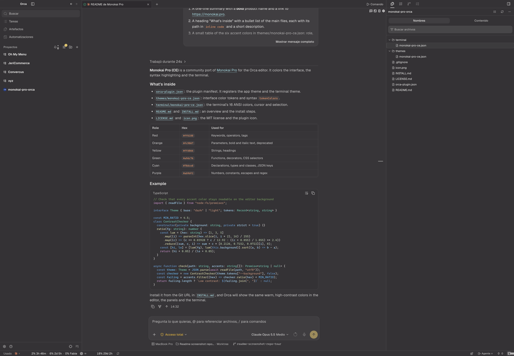

# Monokai Pro (CE) for [Orca](https://www.onorca.dev)

## About this theme

This Monokai Pro Community Edition (CE) theme is maintained by [cuni0716](https://github.com/cuni0716) and is based on the original [Monokai Pro](https://monokai.pro) theme. It themes Orca's interface, syntax highlighting and terminal with the default Monokai Pro filter.

[Installation instructions](INSTALL.md)

[MIT License](LICENSE.md)

## Monokai Pro for more apps

